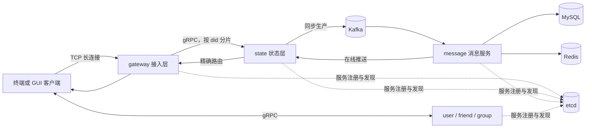

# Plato IM

Plato 是一个使用 Go 编写的分布式即时通讯示例项目。项目将长连接接入、连接状态、消息处理和用户/好友/群组业务拆分为独立服务，覆盖账号注册登录、单聊、群聊、多设备在线、离线消息补拉、ACK 重试和消息幂等等常见 IM 场景。

项目最终构建为一个 `plato` 二进制，通过 Cobra 子命令启动不同服务，适合学习 IM 消息链路、微服务通信、服务发现和可靠消息投递。

## 系统架构



| 模块 | 职责 |
| --- | --- |
| `gateway` | 接入 TCP 长连接，完成拆包、封包、连接管理和转发，不处理业务语义 |
| `state` | 处理登录、重连、心跳、会话序号、ACK、超时重推和在线状态 |
| `domain/message` | 消费 Kafka 消息、幂等落库、维护最近消息缓存、在线推送和离线补拉 |
| `domain/user`、`domain/friend`、`domain/group` | 提供账号认证、设备绑定、好友关系和群组管理能力 |
| `common` | 提供协议、配置、缓存、消息队列、路由、服务发现、RPC 和客户端 SDK 等公共能力 |

## 核心功能

- 账号注册与密码登录，一个账号可绑定多个设备 `did`。
- 支持单聊、群聊、好友申请、好友管理、建群和邀请成员。
- 支持心跳、断线重连、下行 ACK、超时重推和实时消息缺口补拉。
- 使用 MySQL 保存消息事实数据，Redis 缓存每个会话最近 100 条消息。
- 同时提供终端客户端和可通过浏览器访问的 Fyne GUI 客户端。

## 技术栈

| 分类 | 技术 |
| --- | --- |
| 服务端 | Go 1.25、Cobra、gRPC、Protocol Buffers、GORM |
| 接入层 | TCP、自定义长度前缀协议、Linux epoll、ants 协程池 |
| 数据与消息 | MySQL、Redis、Kafka |
| 服务治理 | etcd、一致性哈希、自研 PRPC 封装 |
| 客户端 | gocui、Fyne、noVNC |

## 快速启动

### 1. 环境要求

- Docker Engine 及 Docker Compose v2。
- 建议至少准备 4 GB 可用内存。
- 首次构建需要下载 Go 依赖和容器镜像。

`gateway` 使用 Linux epoll。macOS 和 Windows 用户应优先使用 Docker 启动，不要直接在宿主机执行全量构建。

### 2. 启动服务端

在项目根目录执行：

```bash
docker compose up -d --build
docker compose ps
```

默认启动 etcd、Redis、MySQL、Kafka，以及 gateway、state、message、friend、group、user 六个业务服务。

查看服务日志：

```bash
docker compose logs -f gateway state message
```

### 3. 启动 GUI 客户端

```bash
docker compose --profile gui up -d --build guiclient
```

浏览器访问 [http://localhost:6080](http://localhost:6080)。登录页支持“注册并登录”，填写：

1. 输入账号和至少 6 位密码。
2. 注册时可填写昵称。
3. 输入一个非零数字作为当前设备 `did`，例如 `1001`。
4. 保留默认 Gateway 地址和端口。
5. 点击“注册并登录”。

### 4. 启动终端客户端

```bash
docker compose run --rm client
```

终端客户端只支持登录已有账号。新账号需要先通过 GUI 的“注册并登录”创建。

登录后输入 `/help` 查看全部命令，常用命令如下：

```text
/conversations              查看单聊和群聊会话
/addfriend <did> [附言]     发送好友申请
/requests                   查看收到的好友申请
/chat <userID>              进入单聊
/group <groupID>            进入群聊
```

选中会话后直接输入文字并按 Enter 即可发送消息，按 `Ctrl+C` 退出终端客户端。

### 5. 停止项目

```bash
docker compose --profile gui stop
```

该命令只停止容器，可用 `docker compose --profile gui start` 再次启动。需要删除容器和网络时执行 `docker compose --profile gui down`；追加 `-v` 会同时删除 Compose 数据卷并清空本地测试数据。

## 双账号聊天示例

1. 在 GUI 中注册账号 A，设备 `did` 使用 `1001`。
2. 退出账号 A，在 GUI 中注册账号 B，设备 `did` 使用 `2001`。
3. GUI 重新登录账号 A，再运行 `docker compose run --rm client` 登录账号 B。
4. 一方通过对方的 `did` 发送好友申请，另一方接受后打开好友会话。
5. 在会话中发送消息，断开客户端后重新登录可验证离线补拉。

## 本地开发

Linux 环境可在依赖服务地址与 `plato.yaml` 一致时直接运行：

```bash
go run . --config ./plato.yaml gateway
go run . --config ./plato.yaml state
go run . --config ./plato.yaml message
go run . --config ./plato.yaml friend
go run . --config ./plato.yaml group
go run . --config ./plato.yaml user domain
```

常用验证命令：

```bash
go test ./path/to/changed/package
gofmt -w path/to/changed.go
git diff --check
go build -o /tmp/plato .
```

本地运行读取 `plato.yaml`，容器运行读取镜像内的 `plato.docker.yaml`。两份配置中的服务地址不同，不能混用。

## 项目亮点

1. **职责边界清晰**：gateway 只处理连接与转发，state 管理连接可靠性，领域服务负责业务和持久化，便于独立演进与定位问题。
2. **消息可靠性完整**：上行消息在 Kafka 确认后才返回 ACK；消费端使用数据库唯一约束保证幂等，并通过 ACK、重推和离线补拉减少消息丢失。
3. **支持水平扩展**：服务通过 etcd 注册发现，state 使用一致性哈希按 `did` 分片，在线推送通过路由精确命中连接所在节点。
4. **读写链路兼顾性能与正确性**：MySQL 是消息事实来源，Redis ZSET 缓存会话最近 100 条消息；缓存缺失或不完整时自动回源数据库。
5. **示例链路完整**：仓库同时包含服务端、SDK、终端客户端、GUI、Docker 编排和测试，可直接观察消息从发送、落库到推送和补拉的全过程。

## 关键设计约束

- `did` 表示设备，不代表账号；账号身份由登录后的 session token 确定。
- 单聊和群聊消息按 `conversationID` 只保存一份，不按用户或设备复制正文。
- Kafka 使用 at-least-once 语义，数据库幂等和避免重复推送必须同时保证。
- 会话 `seq` 允许出现空洞，客户端按序展示，但不能假设序号连续。
- Redis 用于路由、状态和热点缓存；MySQL 始终是消息正文的事实来源。

## 项目结构

```text
.
├── cmd/                 # Cobra 子命令入口
├── gateway/             # TCP 接入层
├── state/               # 连接状态与可靠投递
├── domain/              # message、user、friend、group 领域服务
├── common/              # 公共协议、SDK、RPC、缓存和路由
├── client/              # 终端客户端
├── guiclient/           # Fyne GUI 客户端
└── docker-compose.yml   # 完整运行环境编排
```
